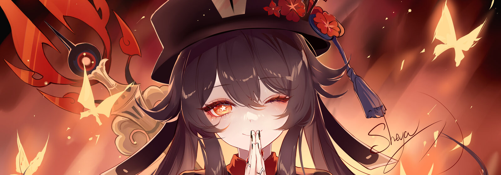
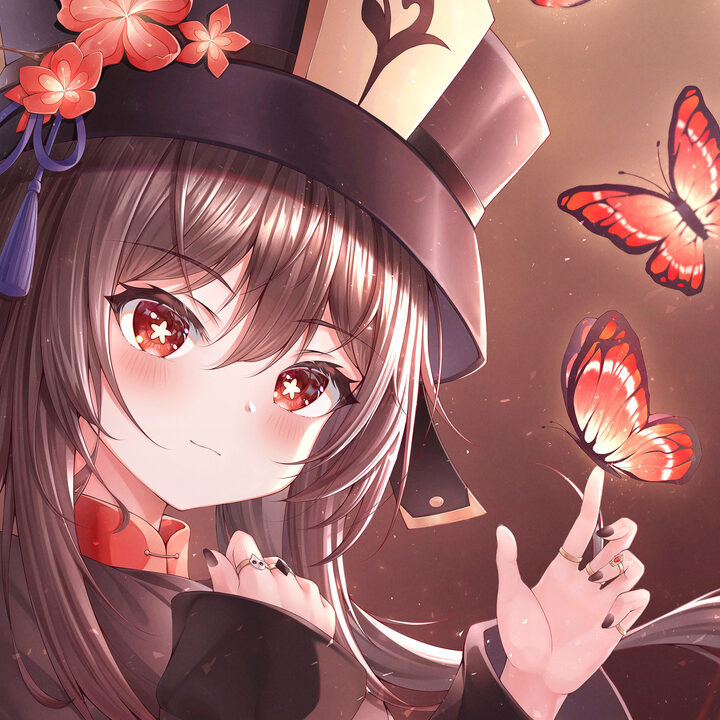

<!-- ═══════════════════  往 生 堂  ·  W A N G S H E N G  ═══════════════════ -->

<div align="center">




<a href="https://github.com/TariatiinEserguu">
  
</a>

<br/>

[](https://ctftime.org/user/268844)
[](https://ctftime.org/team/453547)
[](https://app.hackthebox.com/users/897628)

<sub>🌸 &nbsp;·&nbsp; 🦋 &nbsp;·&nbsp; 👻 &nbsp;·&nbsp; 🔥 &nbsp;·&nbsp; 🦋 &nbsp;·&nbsp; 🌸</sub>

</div>

---

## 🦋 &nbsp;The Director's Card



```console
hutao@wangsheng:~$ whoami
Tariatiin Eserguu — developer · CTF & cybersecurity enthusiast · ESP32 tinkerer

hutao@wangsheng:~$ cat ./ledger.txt
  ┌──────────────────────────────────────────────────────────────┐
  │  往生堂 · WANGSHENG PARLOR · client record                   │
  ├──────────────────────────────────────────────────────────────┤
  │  ROLE      CTF player · challenge author · platform admin    │
  │  TEAM      3v3nt H0r1z0n                                     │
  │  CURRENT   VOID//CTF — my own CTFd + a hand-written pack     │
  │  ALSO      offline-first apps · embedded control · 4D math   │
  │  SCOPE     my own machines and labs only                     │
  └──────────────────────────────────────────────────────────────┘

hutao@wangsheng:~$ ./boo --status
[👻] 一緒に遊ぼう？ ... one commit at a time
```

I like building things that actually run — on a phone with no signal, on a
microcontroller bolted to a robot, on a box on my own LAN. Most of my free time
goes into **CTF**: playing it, and **building the platform and writing the
challenges**, because designing a challenge teaches you the bug twice.

<sub>🌸 Clean data models, readable code, and understanding the layer just below the one I'm working in.</sub>

<br clear="right"/>

---

## 🔥 &nbsp;Ceremonial Tools

<div align="center">

**languages**<br/>


**security & self-hosting**<br/>


**apps & web**<br/>


**embedded, graphics & tooling**<br/>


<sub>Everything above appears in a public repo on this account. If it isn't listed, I haven't shipped with it yet.</sub>

</div>

---

## ⚑ &nbsp;The Night Shift — CTF Lab

<table>
<tr>
<td width="50%" valign="top">

### 🏮 Where I play

| | |
|---|---|
| ⚑ **CTFtime** | [tariatiineserguu](https://ctftime.org/user/268844) |
| 🛡 **Team** | [3v3nt H0r1z0n](https://ctftime.org/team/453547) |
| 🟩 **Hack The Box** | [profile #897628](https://app.hackthebox.com/users/897628) |
| 🏗 **Running** | [VOID//CTF](https://github.com/TariatiinEserguu/Templated-CTFd) |

</td>
<td width="50%" valign="top">

### 🌸 What I've written

| Category | Challenge |
|---|---|
| 🔐 Crypto | *Signal in the Noise* |
| 🔎 Forensics | *Ghost in the Metadata* |
| 🛰 OSINT | *The Lighthouse Keeper* |
| 🕸 Web | *Staff Only* |
| ⚙ Rev | *Deep Signal* |

</td>
</tr>
</table>

```console
hutao@wangsheng:~/lab$ cat hardening.log
[+] read-only containers        [+] dropped capabilities
[+] loopback-only binds         [+] internal-only networks
[+] python tooling: CTFd API loader · asset builder · smoke tests
[ ] pwn / stego                 # queued — nothing to show until there is
```

**Write-ups:** none public yet — I'd rather this stay empty than padded. The
other side of the table is open, though: intended solutions for my own
challenges live in
[`SOLUTIONS.md`](https://github.com/TariatiinEserguu/Templated-CTFd/blob/main/challenges/starter-pack/SOLUTIONS.md)
<sub>(spoilers, obviously 👻)</sub>.

---

## 🕯 &nbsp;Parlor Records

<div align="center">

<picture>
  <source media="(prefers-color-scheme: dark)" srcset="https://github-readme-stats.vercel.app/api?username=TariatiinEserguu&show_icons=true&hide_border=true&bg_color=0b0b0d&title_color=d13b3b&icon_color=e8853f&text_color=c8c8d0&rank_icon=github" />
  
</picture>
<picture>
  <source media="(prefers-color-scheme: dark)" srcset="https://github-readme-stats.vercel.app/api/top-langs/?username=TariatiinEserguu&layout=compact&hide_border=true&langs_count=8&bg_color=0b0b0d&title_color=d13b3b&text_color=c8c8d0" />
  
</picture>

<picture>
  <source media="(prefers-color-scheme: dark)" srcset="https://streak-stats.demolab.com?user=TariatiinEserguu&hide_border=true&background=0b0b0d&stroke=2a2a30&ring=d13b3b&fire=e8853f&currStreakLabel=d13b3b&sideLabels=c8c8d0&currStreakNum=ececf1&sideNums=ececf1&dates=8b8b94" />
  
</picture>

<sub>Cards by community services (github-readme-stats, streak-stats), not official GitHub figures.</sub>

</div>

---

## 👻 &nbsp;A Word from the Director


```console
hutao@wangsheng:~$ ./wangsheng --consult
🦋  「往生堂、本日も通常営業」
     Wangsheng Parlor — open as usual today.

🔥  Every bug gets a proper send-off:
     find it, name it, walk it politely to the exit.

🌸  The plum blooms in winter; the patch ships at 3 a.m.
```

<br clear="left"/>

---

<div align="center">

[](https://github.com/TariatiinEserguu)
[](mailto:tariatiineserguu@gmail.com)

<sub>⚑ ethical labs only · my own machines · ask before you poke ⚑</sub>


<sub>🦋 thanks for dropping by the parlor 🦋</sub>

<sub><i>Hu Tao illustrations are fan art by their respective artists; Hu Tao © HoYoverse. Used non-commercially, no affiliation.</i></sub>

</div>
