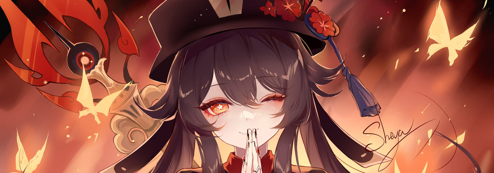

# Tariatiin Eserguu

I build offline-first apps, ESP32 firmware, and graphics experiments in C. I also play CTFs with **3v3nt H0r1z0n**, write challenges, and run a self-hosted CTFd lab.

## Featured projects

| Project | What it does |
| --- | --- |
| [VOID//CTF](https://github.com/TariatiinEserguu/Templated-CTFd) | Self-hosted CTFd lab with a custom terminal theme and an original starter challenge pack. |
| [Busify](https://github.com/TariatiinEserguu/Busify-App) | GPS-based bus stop alerts backed by a local React, Express, and SQLite stack. |
| [Robocon 2027](https://github.com/TariatiinEserguu/Robocon-2027) | ESP32 firmware for our team's Bluetooth-controlled swerve-drive robot. |
| [Tesseract](https://github.com/TariatiinEserguu/Tesseract) | A rotating 4D hypercube projected into 3D, written in C with raylib. |

## Tools I use

- **Apps** · TypeScript, React, React Native, Expo, Express, SQLite
- **Embedded and graphics** · C, C++, ESP32, Arduino, raylib
- **Labs and tooling** · Python, Linux, Docker, CTFd

## Find me

[CTFtime](https://ctftime.org/user/268844) · [3v3nt H0r1z0n](https://ctftime.org/team/453547) · [Hack The Box](https://app.hackthebox.com/users/897628) · [Email](mailto:tariatiineserguu@gmail.com)

Hu Tao fan art belongs to its artist. Hu Tao © HoYoverse.
